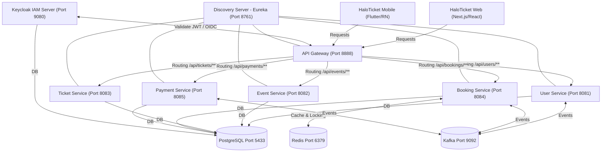

# 🎟️ HaloTicket Backend - Microservices Platform

Backend cho nền tảng bán vé và quản lý sự kiện **HaloTicket**, được xây dựng theo kiến trúc **Microservices** hiện đại dựa trên nền tảng **Spring Cloud**, **PostgreSQL**, **Redis**, **Apache Kafka**, và **Keycloak IAM**.

---

## 📑 Mục lục
- [1. Kiến trúc tổng quan](#1-kiến-trúc-tổng-quan)
- [2. Danh mục dịch vụ & Cổng kết nối](#2-danh-mục-dịch-vụ--cổng-kết-nối)
- [3. Cấu trúc thư mục dự án](#3-cấu-trúc-thư-mục-dự-án)
- [4. Yêu cầu môi trường](#4-yêu-cầu-môi-trường)
- [5. Hướng dẫn khởi chạy nhanh](#5-hướng-dẫn-khởi-chạy-nhanh)
- [6. Xác thực & Phân quyền (Keycloak IAM)](#6-xác-thực--phân-quyền-keycloak-iam)
- [7. Công cụ giám sát & Quản trị (Observability)](#7-công-cụ-giám-sát--quản-trị-observability)
- [8. Kiểm thử API với Postman](#8-kiểm-thử-api-với-postman)
- [9. Quy ước phân nhánh Git & Commit](#9-quy-ước-phân-nhánh-git--commit)

---

## 1. Kiến trúc tổng quan



---

## 2. Danh mục dịch vụ & Cổng kết nối

### 🚀 Backend Services
| Dịch vụ | Thư mục | Port | Database | Công nghệ |
| :--- | :--- | :--- | :--- | :--- |
| **Discovery Server** | `discovery-server` | `8761` | - | Spring Cloud Netflix Eureka |
| **API Gateway** | `api-gateway` | `8888` | - | Spring Cloud Gateway, WebFlux, OAuth2 Resource Server |
| **User Service** | `user-service` | `8081` | `user_db` | Spring Boot, Spring Data JPA, Keycloak Admin Client |
| **Event Service** | `event-service` | `8082` | `event_db` | Spring Boot, Spring Data JPA |
| **Ticket Service** | `ticket-service` | `8083` | `ticket_db` | Spring Boot, Spring Data JPA |
| **Booking Service** | `booking-service` | `8084` | `booking_db` | Spring Boot, JPA, Redis Cache & Locking |
| **Payment Service** | `payment-service` | `8085` | `payment_db` | Spring Boot, VNPay/ZaloPay Integration |

### 🗄️ Hạ tầng cơ sở dữ liệu & IAM (Core Infrastructure)
| Dịch vụ | Container Name | Port ngoài (Host) | Port trong (Docker) | Ghi chú |
| :--- | :--- | :--- | :--- | :--- |
| **PostgreSQL 16** | `haloticket-postgres` | `5433` | `5432` | Tự động tạo 8 databases |
| **Redis 7** | `haloticket-redis` | `6379` | `6379` | Bật AOF và mật khẩu |
| **Apache Kafka** | `haloticket-kafka` | `9092` | `9092` | Chế độ KRaft không cần Zookeeper |
| **Keycloak 24** | `haloticket-keycloak` | `9080` | `8080` | Tự động import Realm `haloticket-realm` |

### 📊 Công cụ giám sát (Observability Tools)
| Công cụ | Container Name | Port ngoài (Host) | Mục đích |
| :--- | :--- | :--- | :--- |
| **pgAdmin 4** | `haloticket-pgadmin` | `5050` | Quản trị giao diện Web cho PostgreSQL (Tự kết nối sẵn) |
| **Kafka-UI** | `haloticket-kafka-ui` | `9090` | Xem topic, message, consumer group của Kafka |
| **RedisInsight** | `haloticket-redis-insight` | `5540` | Giao diện quản lý key, memory, pub/sub của Redis |

---

## 3. Cấu trúc thư mục dự án

```
haloticket-backend/
├── api-gateway/                      # API Gateway định tuyến & verify JWT
├── discovery-server/                 # Eureka Discovery Registry
├── user-service/                     # Quản lý User, eKYC, phân quyền
├── event-service/                    # Quản lý Sự kiện, địa điểm, suất diễn
├── ticket-service/                   # Quản lý Loại vé, mã vé, QR Code
├── booking-service/                  # Xử lý Đặt vé, giữ chỗ, kiểm soát vé
├── payment-service/                  # Tích hợp Cổng thanh toán
├── haloticket-infrastructure/         # Toàn bộ cấu hình Hạ tầng & Docker
│   ├── docker-compose.yml            # Hạ tầng cốt lõi (Postgres, Redis, Kafka, Keycloak)
│   ├── docker-observability.yml      # Công cụ UI giám sát (pgAdmin, Kafka-UI, RedisInsight)
│   ├── .env.example                  # Template biến môi trường
│   ├── .env                          # Biến môi trường thực tế (Local)
│   ├── postgres/init/
│   │   └── 01-create-databases.sql   # Script SQL tạo tự động 8 database
│   ├── keycloak/
│   │   └── realm-export.json         # Cấu hình Realm, Client, Role, User của Keycloak
│   ├── pgadmin/
│   │   └── servers.json              # Auto-connect Postgres server vào pgAdmin
│   └── postman/
│       └── HaloTicket-Keycloak.postman_collection.json # Collection test API Auth
├── docker-compose.yml                # File compose ở root trỏ về hạ tầng chính
├── .env.example                      # Template biến môi trường ở root
├── .gitignore
└── README.md
```

---

## 4. Yêu cầu môi trường

- **Java Development Kit (JDK):** Version 21 trở lên
- **Docker & Docker Compose:** Docker Desktop mới nhất
- **Build Tool:** Maven 3.9+ (hoặc dùng `./mvnw` có sẵn trong mỗi service)
- **Node.js (tùy chọn):** 18+ nếu chạy frontend

---

## 5. Hướng dẫn khởi chạy nhanh

### Bước 1: Chuẩn bị biến môi trường
Tại thư mục gốc `haloticket-backend`, sao chép file cấu hình mẫu:
```bash
# Trên Windows (PowerShell)
copy .env.example .env

# Trên Linux / macOS
cp .env.example .env
```

*(Thực hiện tương tự bên trong thư mục `haloticket-infrastructure` nếu chạy docker từ thư mục con)*.

---

### Bước 2: Khởi động Hạ tầng Cốt lõi (Docker)
Chạy lệnh khởi động PostgreSQL, Redis, Kafka và Keycloak:
```bash
docker-compose up -d
```
> 💡 Keycloak sẽ tự động khởi tạo database `keycloak_db` và nạp toàn bộ cấu hình Realm `haloticket-realm` mà bạn không cần phải thao tác thủ công.

Kiểm tra trạng thái các container:
```bash
docker ps
```

---

### Bước 3: (Tùy chọn) Khởi động Công cụ Giám sát
Khi cần xem dữ liệu PostgreSQL, theo dõi Kafka Topics hoặc Redis Cache:
```bash
docker-compose -f haloticket-infrastructure/docker-observability.yml up -d
```
- **pgAdmin:** Truy cập [http://localhost:5050](http://localhost:5050) (User: `admin@haloticket.com` / Pass: `admin`). Đã có sẵn kết nối `HaloTicket Postgres (Local)`.
- **Kafka-UI:** Truy cập [http://localhost:9090](http://localhost:9090) để xem message realtime.
- **RedisInsight:** Truy cập [http://localhost:5540](http://localhost:5540) để quản lý cache key.

Khi debug xong, bạn có thể tắt cụm giám sát để giải phóng RAM:
```bash
docker-compose -f haloticket-infrastructure/docker-observability.yml down
```

---

### Bước 4: Khởi chạy các dịch vụ Backend theo thứ tự

1. **Khởi chạy Discovery Server trước tiên:**
   ```bash
   cd discovery-server
   ./mvnw spring-boot:run
   ```
   *Dashboard Eureka sẽ sẵn sàng tại:* [http://localhost:8761](http://localhost:8761)

2. **Khởi chạy API Gateway:**
   ```bash
   cd api-gateway
   ./mvnw spring-boot:run
   ```

3. **Khởi chạy các Business Services:**
   ```bash
   # Mở các terminal riêng cho từng service:
   cd user-service && ./mvnw spring-boot:run
   cd event-service && ./mvnw spring-boot:run
   cd ticket-service && ./mvnw spring-boot:run
   cd booking-service && ./mvnw spring-boot:run
   cd payment-service && ./mvnw spring-boot:run
   ```

---

## 6. Xác thực & Phân quyền (Keycloak IAM)

Keycloak được cấu hình sẵn Realm **`haloticket-realm`**:
- **Trang quản trị Keycloak Admin:** [http://localhost:9080](http://localhost:9080)
  - Username: `admin` / Password: `admin`
- **OIDC Discovery URL:** `http://localhost:9080/realms/haloticket-realm/.well-known/openid-configuration`
- **Token Endpoint:** `http://localhost:9080/realms/haloticket-realm/protocol/openid-connect/token`

### Các Client đã cấu hình sẵn:
1. **`user-service`** (Confidential Client):
   - Client Secret: `user-service-secret`
   - Bật Service Account để `user-service` gọi Admin REST API tạo tài khoản, đổi mật khẩu, gán role.
   - Bật Direct Access Grants để hỗ trợ login email/password từ API custom.
2. **`haloticket-web`** (Public Client):
   - Dành cho Next.js / React Web Frontend với chuẩn bảo mật PKCE (S256).
   - Cho phép redirect về `http://localhost:3000/*`, `http://localhost:5173/*`.
3. **`haloticket-mobile`** (Public Client):
   - Dành cho Flutter / React Native App với PKCE (S256).
4. **`api-gateway`** (Resource Server Client):
   - Xác thực token JWT Bearer và trích xuất roles xuống các microservice.

### Các Roles hệ thống:
- `ROLE_ADMIN`: Quản trị viên toàn hệ thống.
- `ROLE_ORGANIZER`: Ban tổ chức sự kiện (tạo sự kiện, phát hành vé).
- `ROLE_STAFF`: Nhân viên soát vé sự kiện.
- `ROLE_USER`: Khách hàng mua vé thông thường (Role mặc định).

### Tài khoản thử nghiệm có sẵn:
| Username | Password | Email | Vai trò (Roles) |
| :--- | :--- | :--- | :--- |
| `admin` | `admin123` | `admin@haloticket.com` | `ROLE_ADMIN`, `ROLE_USER` |
| `organizer` | `organizer123` | `organizer@haloticket.com` | `ROLE_ORGANIZER`, `ROLE_USER` |
| `user` | `user123` | `user@haloticket.com` | `ROLE_USER` |

---

## 7. Kiểm thử API với Postman

Dự án cung cấp sẵn bộ Postman Collection tại:
👉 [haloticket-infrastructure/postman/HaloTicket-Keycloak.postman_collection.json](file:///d:/HaloTicket/HaloTicket_Repo/haloticket-backend/haloticket-infrastructure/postman/HaloTicket-Keycloak.postman_collection.json)

**Các kịch bản test có sẵn:**
1. **OIDC Discovery:** Kiểm tra các endpoint OpenID Connect.
2. **Get Admin Token:** Lấy Bearer Token quyền Admin Keycloak.
3. **Customer Login (Direct Grant):** Đăng nhập tài khoản `user/user123` nhận JWT Access Token.
4. **Organizer Login:** Đăng nhập tài khoản `organizer/organizer123`.
5. **Refresh Token:** Đổi mới Access Token khi hết hạn.
6. **Get User Info:** Xem thông tin profile từ Access Token.
7. **Admin Create User:** Gọi Admin REST API tạo user mới từ xa.

---

## 8. Quy ước phân nhánh Git & Commit

Dự án áp dụng mô hình **Git Flow cho Monorepo**:

### Nhánh chính:
- `main`: Code Production ổn định tuyệt đối (khóa commit trực tiếp).
- `develop`: Nhánh tích hợp chính cho môi trường Dev / Staging.

### Quy ước đặt tên nhánh tính năng:
- `feature/<service-or-scope>/<tên-chức-năng>`: Phát triển tính năng mới.
  - Ví dụ: `feature/user/keycloak-auth`, `feature/payment/vnpay-gateway`, `feature/infra/keycloak-setup-observability`.
- `fix/<service-or-scope>/<tên-lỗi>`: Sửa lỗi trong quá trình dev/test.
- `hotfix/<tên-lỗi-khẩn-cấp>`: Sửa lỗi trực tiếp từ `main`.

### Quy ước Commit (Conventional Commits):
```bash
git commit -m "feat(user): integrate keycloak user registration api"
git commit -m "fix(payment): resolve signature verification error"
git commit -m "chore(infra): update docker healthcheck parameters"
```